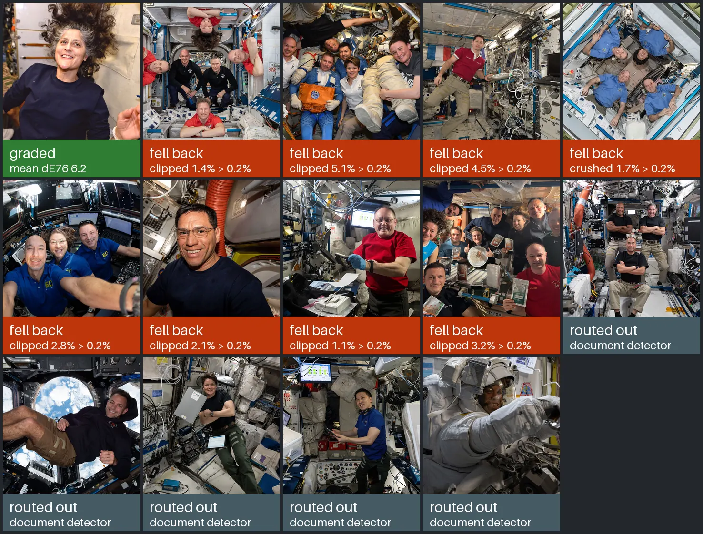
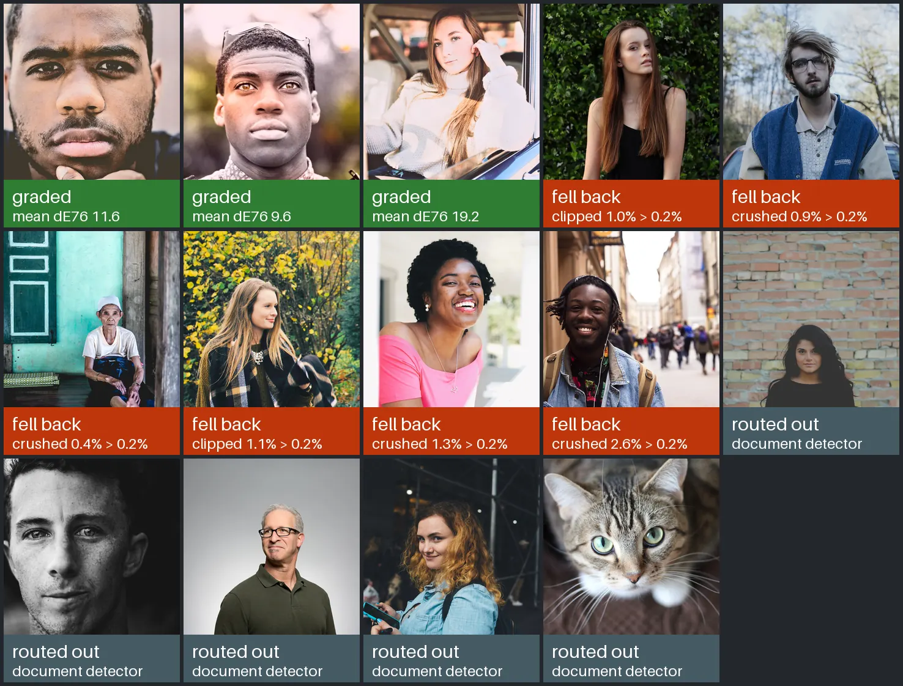
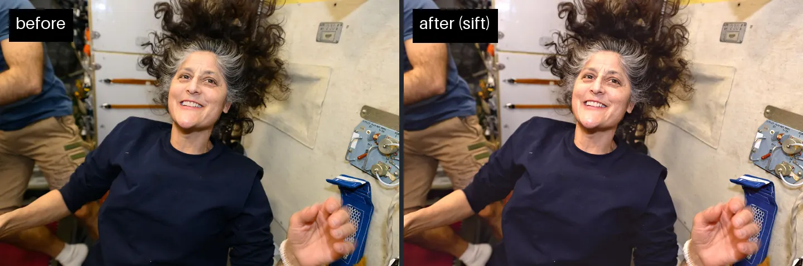

# sift

[](https://github.com/brettadams0/sift/actions/workflows/ci.yml)
[](LICENSE)

An Android app for clearing a camera roll, with an on-device photo grader that is allowed to
say no. You swipe through photos to keep or reject them, and the rejects are trashed in one
confirmation. Each keeper is then measured and given its own correction, and the result has to pass
six quality gates before it replaces anything; when a gate fails, the original ships untouched. Of
28 public-domain photographs run through the unmodified pipeline, 4 were graded and passed, 14 were
graded and then refused by a gate, and 10 were wrongly routed away from grading by a bug, since fixed. The original is trashed only after you approve the result.
Everything runs on the phone, which ships with **no `INTERNET` permission** — a build step fails
if one appears. The imaging pipeline is plain Kotlin with no OpenCV, and the machine-learning
upscaler the spec describes is not built: the spec says to A/B it against a plain baseline first,
and that A/B has not run.

**[Download the APK](dist/)** — a signed sideload build for Android 11 or newer (API 30+);
[install guide](docs/INSTALL.md).

 0.2%' or 'crushed 1.7% > 0.2%'. Five grey 'routed out, document detector'.">

## Does it know when to leave a photo alone?

A grader run unattended over someone's whole camera roll is only safe if it can tell when it is
making a photo worse. So the measure here is not how much better the good results look; it is
whether the bad ones are stopped. The pipeline was run exactly as the app calls it — `MASTER`
preset, no face detector, which is what ships — over 28 photographs in two sets of 14:

- **ISS**: NASA snapshots taken aboard the space station under cabin lighting, the closest
  public-domain stand-in for a phone camera roll. That is the grid at the top of this page.
- **Stock**: CC0 professional photographs, already graded by whoever published them; 13 portraits
  and a cat.

Every input is pinned by URL, licence and sha256 in
[`tools/samples/sources.json`](tools/samples/sources.json).

 0.2%' or 'crushed 2.6% > 0.2%'. Five grey 'routed out, document detector', including a black-and-white portrait and the cat.">

| 28 photographs | ISS | Stock | Measured | Limit |
|---|---:|---:|---:|---:|
| Graded and passed every gate | 1 | 3 | mean ΔE76 6.2 – 19.2 | — |
| Graded, then refused: new clipping | 7 | 2 | **1.0 – 5.1%** of the frame | 0.2% |
| Graded, then refused: shadow crush | 1 | 4 | **0.4 – 2.6%** of the frame | 0.2% |
| &nbsp;&nbsp;refused in total, original shipped | 8 | 6 | **14 of 28** | |
| Routed out as non-photographic (a bug) | 5 | 5 | 10 of 28 | |

Fourteen photographs were graded, measured as worse by the spec's own rule, and handed back
untouched. That is the gates working. A photo that failed both gates is counted under the one it
missed by more; every gate it failed is in its row of the results file. The ISS set was refused
mostly for new clipping, the stock set mostly for crushed shadows — with 14 photos in each, an
observation rather than a rate. Both limits are the spec's — no more than 0.2% of the frame
newly clipped, no more than 0.2% newly crushed (§6.12) — and nothing was tuned for this run.
([`GateResults.kt`](core/model/src/main/kotlin/dev/sift/model/GateResults.kt),
[`QualityGates.kt`](core/imaging/src/main/kotlin/dev/sift/imaging/QualityGates.kt))

Every clipping refusal was 5 to 25.5 times the limit (1.0% and 5.1% of the frame against 0.2%).
The obvious explanation would be the input — stock photographs are already edited, so there is
little to fix and room to overshoot — and the data rules it out. The ISS set, chosen because it is
the closer match to a camera roll, did worse: 1 of 14 graded and passed, against 3 of 14 for stock.

So the limits were tested instead of moved, and they are right. **The grade was too aggressive, and
the gates caught it.** Re-running the graded photos with every attempt traced: 11 of the 14
refusals are portraits, and the first attempt lifted skin by +6.7 to +27.5 L\*, then added an
exposure correction on top, which newly clipped 2.4–10.2% of the frame. Three defects in
`PortraitGrade` account for it:

- Dim indoor skin, around L\* 40–50, is driven toward a fixed target by +17 to +27 L\*, and the
  exposure correction stacks on top of that.
- Exposure is computed from the median *before* the skin lift, so it counts the lift twice.
  Fixing that alone rescues 1 of the 11.
- The portrait highlight shoulder aims at L\* 100, while the gate counts anything above L\* 98 as
  clipped. Scene already stops at 97.5 (`COMPOSED_WHITE_CEILING_L`). Fixing that lowers clipping on
  two photos and rescues none.

They are named here and not fixed yet. This is the design doing what it is for: a grader is going
to be wrong sometimes, and a gate that refuses a bad result is what makes running it unattended
safe. One gap the trace exposed: a refused grade keeps the gate values in its reason, but not the
parameters it tried, so the app cannot yet explain a refusal from its own records.
([`PortraitGrade.kt`](core/imaging/src/main/kotlin/dev/sift/imaging/PortraitGrade.kt),
[`FrameAnalyzer.kt`](core/imaging/src/main/kotlin/dev/sift/imaging/FrameAnalyzer.kt),
[`SceneGrade.kt`](core/imaging/src/main/kotlin/dev/sift/imaging/SceneGrade.kt))

The four that passed moved a long way: mean ΔE76 of 6.2 on the ISS photograph, and 11.6, 9.6 and
19.2 on the three stock portraits. All four got lighter, by ΔL\* +4.3 to +18.1, and two shifted
colour more than they lightened: Δb\* +9.1 (yellower) on one, Δa\* +6.6 (redder) on another. That measures
how far the pixels moved, not that they moved toward anything better; there is no reference to
score skin against. Two of the stock grades show it: one picks up a magenta cast in the sky, and
the 19.2 is a washed-out lift. They pass the gates and are still not good, which is why none of
them is the picture at the top of this page. The one in-domain pass is a modest change — slightly brighter and
warmer:



The ten routed out are a bug, not restraint. The document detector, `isLikelyDocument`, classed
real photographs as documents — five from each set — and they were exported ungraded. One is a
black-and-white portrait, where skipping the grade is arguably right; the rest are colour
photographs, and one is the cat. The cause: the detector requires a bimodal brightness histogram,
and its floor of 0.55 is below 2/π ≈ 0.64, the score of any normal distribution, so every
photograph passed it — these measured 0.697–0.850. Edge density passed for all of them too, which
left low colour as the entire test. The floor is now 0.86; rendered pages of ink on paper measure
0.869–0.955, and `DocumentDetectionTest` fails four of its five cases at 0.55 and passes them at
0.86
([`DocumentDetectionTest.kt`](core/imaging/src/test/kotlin/dev/sift/imaging/DocumentDetectionTest.kt)). The margin is narrow, and the document side of it is rendered pages, not phone photos of
paper, so a dim, low-contrast photo of a real document may now be graded as a photograph. The grids
above were made before the fix. Screenshot detection fired on none of the 28.
([`FrameAnalyzer.kt`](core/imaging/src/main/kotlin/dev/sift/imaging/FrameAnalyzer.kt))

Caveats: 28 photographs is not a camera roll, and the inputs are 1920 px renders from Wikimedia
Commons, not camera originals. The per-photo record — outcome, gate, measured value, ΔE76 and its
L\*, a\*, b\* components — is in [`results/grade-samples.json`](results/grade-samples.json).
With JDK 17 and Pillow, one command regenerates it and every committed image byte for byte —
checked by comparing sha256 before and after a rerun:

```sh
python tools/samples/make_assets.py
```

## How it works

### Triage

The library is scanned through MediaStore, decoding each photo at no more than 1024 px on the long
edge, which is what the perceptual hash needs. Near-duplicates are clustered by dHash, and
screenshots are detected. Swipes are recorded in Room and can be
undone; nothing is deleted until the batch is confirmed.
([`MediaStoreRepository.kt`](core/data/src/main/kotlin/dev/sift/data/media/MediaStoreRepository.kt),
[`PerceptualHash.kt`](core/imaging/src/main/kotlin/dev/sift/imaging/PerceptualHash.kt))

### Grading

Each keeper is measured — tone and clipping, colour cast, chroma, skin, sharpness, noise,
faces — and routed to a Portrait or a Scene
grade. A photo counts as a portrait when a face is found or skin covers more than 8% of it
(`faceCount > 0 || skinFraction > 0.08`). Every parameter is derived from that frame's
measurements; constants exist only as targets and bounds, which is the spec's first rule. Values
stay unbounded float end to end, so nothing clamps between stages (§2.1). Per-pixel passes run in parallel by row, except dither, which
uses a seeded random sequence and is parallelised over fixed chunks so its output stays
reproducible.
([`FrameAnalyzer.kt`](core/imaging/src/main/kotlin/dev/sift/imaging/FrameAnalyzer.kt),
[`FrameAnalysis.kt`](core/model/src/main/kotlin/dev/sift/model/FrameAnalysis.kt),
[`FaceDetector.kt`](core/imaging/src/main/kotlin/dev/sift/imaging/FaceDetector.kt),
[`Parallel.kt`](core/imaging/src/main/kotlin/dev/sift/imaging/Parallel.kt))

### Quality gates

Six gates check the result: skin range, no new clipping, no shadow crush, sharpness preserved, no
banding, chroma sanity. When one fails, the grade is retried along the remedy chain in §6.12,
and if it still fails the original ships and the report says which gate refused it. A degraded
photo is worse than an unprocessed one.
([`QualityGates.kt`](core/imaging/src/main/kotlin/dev/sift/imaging/QualityGates.kt),
[`GateResults.kt`](core/model/src/main/kotlin/dev/sift/model/GateResults.kt))

### Approval and trash

The original is trashed only when all five invariants in §9.3 hold — among them that the export
still decodes, checked at that moment rather than at write time. `ApprovalGuard` is the single place
that decision is made. Rejected photos and approved originals are separate kinds of request with
separate confirmations, because agreeing to one is not agreeing to the other. Every lifecycle
transition is written to Room before any file is touched, so a process killed mid-transition
resumes instead of trashing twice.
([`ApprovalGuard.kt`](core/data/src/main/kotlin/dev/sift/data/media/ApprovalGuard.kt),
[`TrashCoordinator.kt`](core/data/src/main/kotlin/dev/sift/data/media/TrashCoordinator.kt),
[`LifecycleRepository.kt`](core/data/src/main/kotlin/dev/sift/data/media/LifecycleRepository.kt))

## Three places it departs from the spec

The app is built to [`SIFT_SPEC.md`](docs/SIFT_SPEC.md) v3. These are the three places it doesn't
follow it, and each is a judgement worth arguing with. The first is the same rule as the gates,
applied to the code instead of the photo: nothing ships until it has been measured against
leaving things alone.

### The ML upscaler is not built

This is the spec being followed, not departed from. A grade has to beat the original or it doesn't
ship; a model has to beat the baseline or it doesn't get built. §6.6 ends with an instruction:

> Before writing any ONNX code: A/B it. Build a Lanczos + unsharp baseline. Compare on ten of your
> real photos at 100%. If the difference doesn't justify 30 seconds per image and a native
> dependency, ship the baseline and delete this section.

So what exists is the baseline, the gate that decides whether to upscale at all, the interface a
model would plug into, the two treatments that stop a learned upscaler looking synthetic — written
against that interface — and the harness that runs the comparison. What does not exist is a
Real-ESRGAN session, because building it first would mean doing the work the spec says to justify. Face detection depends on the same decision, and the router works
without a detector by falling back to the skin rule.
([`Upscale.kt`](core/imaging/src/main/kotlin/dev/sift/imaging/Upscale.kt),
[`ModelPolicy.kt`](core/ml/src/main/kotlin/dev/sift/ml/ModelPolicy.kt))

### No OpenCV

The spec lists OpenCV and then names its most dangerous defect: OpenCV ships two different LAB
scalings, and porting the 8-bit form's `-128` arithmetic into a float pipeline "silently produces
garbage that still looks like a plausible image". The spec's only defence is a golden test.

Writing the conversion directly removes the trap instead of guarding it. There is no 8-bit LAB
path here to confuse with the float one. `ColorSpaces` produces true CIELAB and nothing else, with
the sRGB transfer curve as an 8192-entry interpolated table, and the exact formula used outside
[0, 1], where the pipeline's unbounded values live. `LabGoldenTest` pins it to published reference
values rather than to another implementation, so it can't drift in step with a mistaken one — a
neutral grey must come out with `a*, b*` near 0, not near 128. The cost is several hundred lines of
image maths and no SIMD, which shows up in the time budget (see below).
([`ColorSpaces.kt`](core/imaging/src/main/kotlin/dev/sift/imaging/ColorSpaces.kt),
[`LabGoldenTest.kt`](core/imaging/src/test/kotlin/dev/sift/imaging/LabGoldenTest.kt))

### A hand-written JPEG encoder

§2.4 requires 4:4:4 chroma — no colour subsampling. Without OpenCV the platform option is
`Bitmap.compress`, which takes a quality number and nothing else; whether it subsamples depends on
whichever Skia build the phone has. That turns a requirement into a hope. `JpegEncoder` is a
baseline encoder with two-pass optimised Huffman tables, and `JpegEncoderTest` doesn't trust its
own flag: it parses the SOF0 marker of real output and asserts 1×1 sampling on all three
components.
([`JpegEncoder.kt`](core/imaging/src/main/kotlin/dev/sift/imaging/JpegEncoder.kt),
[`JpegEncoderTest.kt`](core/imaging/src/test/kotlin/dev/sift/imaging/JpegEncoderTest.kt))

## Running it

Install the APK from [`dist/`](dist/); [`docs/INSTALL.md`](docs/INSTALL.md) covers sideloading and
first-run permissions. Every release is signed with the same key, so each one installs over the
last as an update.

To build, JDK 17. The imaging pipeline needs nothing else; the app needs an Android SDK named in
`local.properties` (`sdk.dir=...`).

```sh
./gradlew :core:imaging:test   # the pipeline; no Android SDK needed
./gradlew build                # everything
./gradlew assembleRelease      # the sideloadable APK
./gradlew :core:imaging:test -Dsift.bench=true   # also runs PipelineBenchmark, which is opt-in
```

`settings.gradle.kts` includes the Android modules only when an SDK is present, so the first
command works on a machine that has never installed one.

## Development

```sh
./gradlew :core:model:build :core:imaging:test :core:testing:build   # no Android SDK
./gradlew assembleDebug assembleRelease
./gradlew :app:verifyNoNetworkPermissionsRelease
git status --porcelain core/data/schemas                              # must print nothing

# on emulators, API 30 and API 35
./gradlew :core:data:connectedDebugAndroidTest :app:connectedDebugAndroidTest
```

The instrumented tests write real files into MediaStore. Run them on an emulator you can wipe.

Three properties are enforced by the build, and each was checked to fail when broken: no network
permission in the merged manifest; Room schemas committed with the entity change that produced
them; and the kotlinx-serialization serializers surviving R8 in the release APK. If an entity
changes on purpose, commit the regenerated schema under `core/data/schemas` in the same commit.

A 12 MP grade is still well over §13's 2.5 s budget on emulated hardware, and before 0.2.5 it did
not complete at full resolution at all (confirmed fixed on device in 0.2.8) — every large photo was silently graded at half resolution
and shipped that way. That history, with the memory work that fixed it, is in
[`docs/PERFORMANCE.md`](docs/PERFORMANCE.md). What the tests prove, what they don't, and what the
device suite found on its first run are in [`docs/TESTING.md`](docs/TESTING.md). Changes, each with what was wrong and how it was found, are
in [`CHANGELOG.md`](CHANGELOG.md).

## Layout

| Module | |
|---|---|
| `:app` | Compose UI, navigation, view models, WorkManager |
| `:core:model` | shared immutable types; no dependencies |
| `:core:imaging` | the grading pipeline; plain Kotlin — no Android, no OpenCV |
| `:core:ml` | model policy and the upscale A/B harness; no ONNX, deliberately |
| `:core:data` | Room, MediaStore, DataStore, lifecycle and approval safety |
| `:core:testing` | synthetic fixtures, and the slot for golden-image fixtures |
| `docs/` | the spec, the install guide, test evidence, performance history |
| `dist/` | the signed release APK |

## License

MIT — see [LICENSE](LICENSE).
